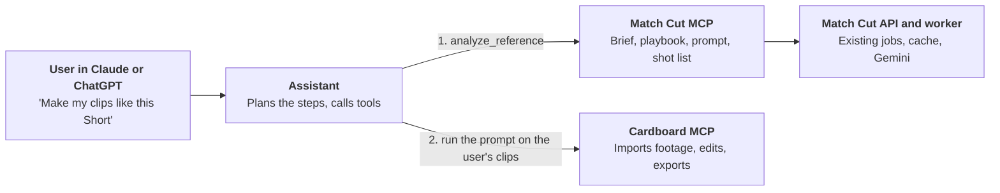
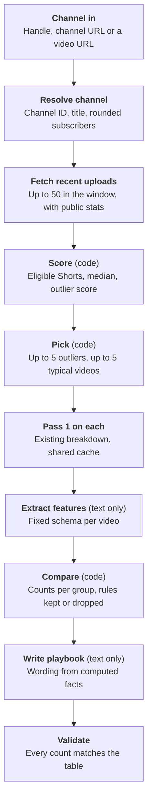

# PRD addendum: Playbooks, the Match Cut MCP tool and shot lists

Last updated: Nov 24, 2026 · Author: Ananya · Status: draft for review · Extends [PRD.md](PRD.md) (v1)

## TL;DR

v1 answers "how was this video made?" for one video. This addendum adds "why did it work, and what is the repeatable recipe?" for a whole channel, and puts Match Cut where AI editing now happens: inside Claude and ChatGPT, next to Cardboard's own connector.

| Feature | What the user gets | Milestone |
| --- | --- | --- |
| **Match Cut MCP tool** | Match Cut as a connector in Claude or ChatGPT; with Cardboard's connector in the same chat, a YouTube link becomes a finished edit of the user's footage | M9 |
| **Shot list** | "Film these shots to recreate this", for users who haven't filmed yet | M9 |
| **Playbooks from public data** | For any YouTube channel: which Shorts beat that channel's normal, what their edits have in common that the rest lack, and a Cardboard-ready recipe | M10 |
| **Saved skills** | A playbook or brief saved as a named, reusable style for every future video | M10 |
| **Own-channel insights** | The user connects their YouTube channel; retention drop-offs are mapped onto Match Cut's beat timeline | M11 |

**Principle: numbers come from code, words come from the model.** Views, outlier scores and "4 of 5 winners do X" counts are computed deterministically. Gemini only describes videos and writes the recommendations from those computed facts.

## Changes to v1 decisions

These need sign-off before M10. Everything else in v1 stands: YouTube only, never download or re-host video, canonical URLs only, keys server-side, pass 1 never sees the user's goal.

| v1 says | This addendum | Why |
| --- | --- | --- |
| Non-goal: "judging whether a reference is good or predicting its performance" | Playbooks **explain past performance** against public view counts. Predicting a new video's performance before publishing stays a non-goal | Users ask "what worked and why", not only "how was it made" |
| Non-goal: "blending several references into one style" | A playbook combines patterns from up to 5 videos of one channel into one recipe. Blending arbitrary references remains out of scope | The recipe has to come from several videos to be more than one video's quirks |
| Two Gemini passes | Adds two text-only steps for playbooks: feature extraction and playbook writing. Briefs keep exactly two passes | Pass 1 stays the only call that watches video, so its cache is reused |
| Later use case: "saved styles" (v1.1) | Pulled into M10 as saved skills | Playbooks produce exactly what a saved style needs |

## Problem

**Cardboard's agent needs guidance, and the guidance has to be right.** In Cardboard's launch thread a commenter noted that "without guidance agents aren't really able to edit video"; Cardboard's own templates are "the exact prompts used to create the videos". v1 turns any video into such a prompt. But a user copying a video they like is guessing: they don't know whether that video worked because of its edit, its topic or luck, or whether its style works for anyone else.

**What creators and growth teams actually need** is the repeatable part: "this channel's breakout Shorts all open on a spoken question in the first second and cut every 1.5 seconds; their average Shorts don't". That is a playbook. It turns one idea into many videos, and more videos made is what grows both Match Cut and Cardboard.

**Existing tools stop short.** Outlier finders (1of10, ViewStats, vidIQ and others) score videos against their channel's average and compare titles, thumbnails and topics. None of them analyzes the edit itself, and none produces something an editing agent can execute.

## Goals, non-goals and success metrics

**Goals**

- From a YouTube channel, find the Shorts that beat the channel's own baseline and explain, with evidence counts, which editing patterns separate them from the rest.
- Turn that explanation into an executable recipe: a Cardboard prompt for the user's footage, a shot list, and a reusable saved skill.
- Be usable from Claude and ChatGPT through MCP, composing with Cardboard's connector without Match Cut ever holding Cardboard credentials.
- Be honest about what the edit explains and what it doesn't.
- Cost under USD 0.30 per playbook on a cold cache.

**Non-goals**

- Predicting how a video will perform before it is published.
- Topic, title, thumbnail or posting-time optimization; outlier tools already do this.
- Instagram and TikTok (v1's YouTube-only decision stands).
- Comparing several channels in one playbook (later).
- Long-form playbooks (later; see Open questions).
- Match Cut calling Cardboard directly or editing video.

**North star metric**

**Videos published per active user per week, made with a Match Cut brief, playbook or saved skill.**

Guardrail: **the share of those videos that beat the creator's own baseline** (outlier score of 1.0 or more, measured 7 days after publishing). Volume alone can be gamed with low-effort output, which is the "AI slop" audiences are rejecting. Volume plus "beats your own normal" shows Match Cut makes people both more productive and better.

Until Cardboard shares export events, measure the north star by proxy: prompts applied or sent to the Director, and, for connected channels, Shorts published within 7 days of an apply.

**Supporting metrics**

| Metric | Proposed target | How it is measured |
| --- | --- | --- |
| Playbook success rate | 90% of valid channels with enough data return a playbook | Job logs |
| Playbook applied | 50% of finished playbooks get at least one apply or saved skill | Frontend and MCP events |
| Rule faithfulness | 100% of rule evidence counts match the computed feature table | Automated check on every playbook |
| Rule usefulness | 70% of rules rated useful in human review | Golden-set review |
| Time to playbook, 10 videos | p50 under 3 min cold, under 30 s warm | Stage timings |
| Cost per playbook | p50 under USD 0.30 cold, under USD 0.05 warm | Token usage logs |
| MCP brief completion | 90% of `analyze_reference` calls end with a prompt in the same chat | MCP server logs |

## Users and use cases

| User | Question they bring | What Match Cut gives them |
| --- | --- | --- |
| Growth or marketing team | "What's working for our competitor's Shorts, and how do we do it with our footage?" | A playbook for the competitor's channel, applied to their footage |
| Solo creator | "Why did my last Short do 5× my normal?" | Own-channel playbook plus retention mapped to beats (M11) |
| Agency | "What's the house style of this client's best-performing videos?" | A saved skill every editor on the account reuses |
| Claude or ChatGPT user with Cardboard connected | "Make my clips like this Short" | Match Cut's brief, executed by Cardboard's connector in the same chat |

**Use cases**

1. Competitor playbook: paste a channel (handle, channel URL or any of its video URLs), get the playbook.
2. Apply: give a goal, format and length; get a Cardboard prompt and shot list built from the playbook.
3. Save as skill: name a playbook or a brief ("Our launch style"); apply it later without re-analysis.
4. Shot list from a brief: "what do I need to film to make something like this?"
5. In Claude: "What's working for @channel? Make three of those from my clips." Match Cut builds the playbook; Cardboard's connector edits and exports.
6. Own channel (M11): connect YouTube; see where viewers leave each Short, tied to the beat on screen at that moment.

## Feature 1: Match Cut MCP tool (M9)

Match Cut exposes a remote MCP server so Claude, ChatGPT and other assistants can call it as a connector. It wraps the existing API; no new analysis logic.

The assistant composes the two connectors. Match Cut never calls Cardboard and never sees Cardboard credentials.

**Tools**

| Tool | Input | Returns |
| --- | --- | --- |
| `analyze_reference` | `url`, optional `goal`, `format`, `length_seconds`, `clip_start_seconds`, `clip_end_seconds` | The brief: prompt, beats, assets needed, watch-outs. If not done within the wait limit, a brief ID and "still working" |
| `get_brief` | `brief_id` | Status, or the finished brief |
| `regenerate_prompt` | `brief_id`, `goal`, `format`, `length_seconds` | A new prompt from the stored breakdown |
| `shot_list` | `brief_id`, optional `goal`, `format`, `length_seconds` (M9); `playbook_id` or `skill_id` (M10) | Ordered list of shots to film, with total length. A new goal, format or length rewrites the brief's prompt too. Briefs without a list get one written, once |
| `build_playbook` | `channel` (handle, channel URL or video URL), optional `window_days`, `max_videos` | Playbook, or a playbook ID and "still working" (M10) |
| `get_playbook` | `playbook_id` | Status, or the finished playbook (M10) |
| `apply_playbook` | `playbook_id` or `skill_id`, `goal`, `format`, `length_seconds` | Cardboard prompt and shot list (M10) |
| `save_skill`, `list_skills` | `name` plus `brief_id` or `playbook_id`; none | The saved skill; the user's skills (M10) |

**Rules**

- Long jobs: a tool call waits up to 45 seconds for the result, then returns the job ID with an instruction to call `get_brief` or `get_playbook`. Tool descriptions tell the assistant to keep polling no more than every 10 seconds.
- Each tool result has a short human-readable text part and a structured part, so assistants can both show and chain it.
- Tool descriptions say that the prompt is meant for Cardboard's connector, and that the user should confirm before the edit runs (v1's "never run without confirmation" rule).
- Transport: remote MCP over HTTPS at `/mcp` on the API service. Verify the current MCP transport and auth requirements for Claude and ChatGPT connectors before building.
- Auth: an API key per user or team from `MCP_API_KEYS`, sent as `Authorization: Bearer <key>` (Claude's custom connectors send fixed request headers). Each key is its own user, with its own briefs and rate limits, in a separate `mcp` org for org-wide limits. No keys configured means the endpoint is off. Anonymous access was rejected because anyone with the URL could spend the Gemini budget. Production moves to OAuth with Cardboard identity once available. No Gemini or YouTube key is ever exposed.
- Same rate limits, caps, caching and logging rules as the HTTP API; goal text is never logged.

## Feature 2: Shot list (M9)

A pass 2 output for users who haven't filmed yet. Built from the breakdown plus the user's goal, like the prompt, so it never re-watches the video.

| Field | Type | Notes |
| --- | --- | --- |
| `shot_list[]` | array | 4 to 15 items, in edit order |
| `shot_list[].shot` | string | What to film, adapted to the user's goal, not the reference's topic |
| `shot_list[].framing` | string | For example "tight close-up, eye level, phone vertical" |
| `shot_list[].duration_seconds` | number | Target on-screen length |
| `shot_list[].maps_to_beat` | integer | Index of the reference beat it recreates |
| `shot_list[].notes` | string | Delivery, lighting or b-roll tips |

`maps_to_beat` is 1-based: 1 is the breakdown's first beat. Pass 2 prompt and schema versions bump when the shot list is added (`p2.v3`), which invalidates pass 2 cache entries only. Semantic checks: 4 to 15 shots, total duration within 25% of the target length (the user's target, else the analyzed length), `maps_to_beat` valid, no URLs, markdown or injected instructions, no run of more than 12 words from the reference's speech.

**The shot list never costs the user their prompt.** It is checked separately from the prompt. Shot-list problems go into the one repair call with everything else; if the list is still wrong after it, or the repair call itself fails, the brief succeeds with its prompt, an empty `shot_list` and the `SHOT_LIST_UNAVAILABLE` warning. That result is not cached, so regenerating really tries again, and a successful regenerate clears the warning.

The shot list comes back on every brief (`shot_list` on the brief object; `null` for briefs made before shot lists). A list for a different goal, format or length uses the existing `POST /v1/briefs/{id}/regenerate`, so no separate endpoint is needed.

| Warning | Message |
| --- | --- |
| `SHOT_LIST_UNAVAILABLE` | We couldn't build a shot list for this video. Regenerate the prompt to try again. |

## Feature 3: Playbooks from public data (M10)

**Request flow**

**Input**: a channel handle (`@name`), a channel URL (`/@name` or `/channel/UC…`), or any video URL from the channel. As in v1, only the parsed channel or video ID is used; the raw URL is never forwarded.

**Data from the YouTube Data API (public, no user sign-in)**

| Data | Used for | Caveat |
| --- | --- | --- |
| Channel ID, title, rounded subscriber count | Header; small-channel note | Subscribers are rounded down to 3 significant figures and can be hidden |
| Recent uploads (uploads playlist) | Candidate videos | 1 quota unit per 50 videos; avoid `search.list` (100 units) |
| Views, likes, comments, publish date, duration | Scoring | Likes can be hidden; Shorts views include replays since Mar 31, 2025 |

Shorts detection: duration of 180 seconds or less. YouTube's API has no official "is Short" field; treat this as a heuristic and record it as a warning when a channel mixes formats. Verify whether a better signal exists before building.

**Scoring (deterministic code, unit-tested)**

1. Window: uploads from the last 90 days (configurable 30 to 180), at most 50.
2. Eligible: Shorts at least 7 days old, so recent uploads aren't penalized for having had less time; younger ones are listed as "too new".
3. Baseline: median views of eligible Shorts. The median, not the average, so one viral video doesn't set the bar.
4. Outlier score = views ÷ baseline. Engagement rate = (likes + comments) ÷ views, shown as a secondary signal.
5. Outliers: score 2.0 or more (configurable), the top 5 by score.
6. Typical: score between 0.5 and 1.5, the 5 closest to 1.0.
7. Minimum data: 10 eligible Shorts and 2 outliers. Otherwise `NOT_ENOUGH_DATA`, with how many were found and a suggestion (longer window, or a brief on a single video instead).

The outlier score is Match Cut's own calculation and must be labeled that way in the UI and API, with its formula one click away.

**Watching**: pass 1 runs on each picked video exactly as for a brief (standard detail, existing caps), up to 3 in parallel per job. Breakdowns are shared across users through the existing pass 1 cache, so popular channels get cheap quickly.

**Feature extraction (text only, cached per breakdown)**

A small Gemini call turns each breakdown into a fixed feature row. `unknown` is always allowed; the model must not guess.

| Feature | Values |
| --- | --- |
| `hook_type` | `question`, `bold_claim`, `result_first`, `visual_surprise`, `story_open`, `other`, `unknown` |
| `first_words_at_seconds` | number or `unknown` |
| `text_on_screen_first_second` | `yes`, `no`, `unknown` |
| `face_in_first_shot` | `yes`, `no`, `unknown` |
| `avg_shot_length_bucket` | `under_1s`, `1_to_2s`, `2_to_4s`, `over_4s` (from `format.avg_shot_length_seconds`) |
| `caption_style` | `word_by_word`, `phrase`, `none`, `unknown` |
| `zoom_punch_ins` | `frequent`, `some`, `none`, `unknown` |
| `music` | `trending_or_upbeat`, `ambient`, `none`, `unknown` |
| `length_bucket` | `under_15s`, `15_to_30s`, `30_to_60s`, `over_60s` (from duration) |
| `ending` | `call_to_action`, `loop`, `cliffhanger`, `abrupt`, `other`, `unknown` |
| `video_type` | From the breakdown |

The feature list is versioned like prompts and schemas; changing it bumps the version and invalidates feature cache entries.

**Comparison (deterministic code)**

For every feature value, count how many outliers and how many typical videos have it, ignoring `unknown`. Keep a candidate rule when:

| Confidence | Rule |
| --- | --- |
| High | Present in at least 80% of outliers and at most 30% of typical videos, with at least 4 outliers known |
| Medium | Difference of at least 40 percentage points between the groups |
| Dropped | Smaller differences, or fewer than 3 known values in either group |

Also computed: features shared by nearly all videos on the channel (the channel's "house style", reported separately), and the outliers' common topics from titles (reported under "what the edit doesn't explain").

**Playbook writing (text only)**

Gemini receives only the computed table, kept rules, house style and the outliers' breakdowns, and writes the recipe:

| Field | Type | Notes |
| --- | --- | --- |
| `rules[]` | array | 1 to 5, ordered by confidence then difference |
| `rules[].title` | string | Imperative, under 8 words: "Open on a spoken question" |
| `rules[].how_to` | string | 1 to 3 sentences in editing terms, numeric where possible |
| `rules[].evidence` | object | `outliers_with`, `outliers_known`, `typical_with`, `typical_known` (copied from code, never written by the model) |
| `rules[].confidence` | enum | `high`, `medium` (from code) |
| `rules[].examples[]` | array | Video ID and timestamp where the pattern shows |
| `rules[].counterexample` | string or null | An outlier that breaks the rule, if any |
| `house_style` | string | What every video on the channel does, so users don't mistake it for the secret |
| `not_explained` | string[] | Factors outside the edit: shared topics, a trend, a collaboration, posting bursts |
| `recipe_prompt_template` | string | A Cardboard prompt template with a slot for the user's goal |

**Validation**: schema check; every `evidence` object must equal the computed counts exactly; every example timestamp must lie within that video's analyzed range; `recipe_prompt_template` passes v1's prompt checks. One repair call on failure, as in v1.

**Playbook object (API response)**

| Field | Notes |
| --- | --- |
| `id`, `status`, `stage` | As for briefs; stages below |
| `channel` | `id`, `title`, `handle`, `subscriber_count_rounded`, `subscriber_count_hidden` |
| `window` | `from`, `to`, `uploads_seen`, `shorts_eligible`, `too_new` |
| `baseline` | `median_views`, `median_engagement_rate` |
| `videos[]` | `id`, `title`, `published_at`, `views`, `likes` (null if hidden), `comments`, `outlier_score`, `group` (`outlier`, `typical`, `other`), `brief_id` |
| `rules[]`, `house_style`, `not_explained`, `recipe_prompt_template` | From playbook writing |
| `warnings[]` | For example `SMALL_SAMPLE`, `MIXED_FORMATS`, `LIKES_HIDDEN`, `TOPIC_CONFOUND`, `RECENT_VIDEOS_EXCLUDED` |
| `meta` | Versions, models, timings, tokens, cost, `cached` |

Statuses are v1's. Stages: `resolving_channel`, `fetching_stats`, `scoring`, `watching` (with `progress: {done, total}`), `extracting`, `comparing`, `writing_playbook`, `validating`.

## Feature 4: Saved skills (M10)

A skill is a named, reusable recipe: either a brief's breakdown or a playbook's rules plus its `recipe_prompt_template`. Applying a skill runs only the text step that writes a prompt and shot list for a new goal, format and length; it never re-watches video.

- Owned by a user; shareable within an organization once Cardboard identity exists.
- Stores the source brief or playbook ID, versions, and a snapshot of the rules, so a skill keeps working after caches expire.
- Re-running the source playbook updates the skill only on request ("Refresh from channel").
- Limits: 50 skills per user.

## Feature 5: Own-channel insights (M11)

The user connects their YouTube channel with Google sign-in (read-only scopes for YouTube data and YouTube Analytics). This unlocks data that isn't public:

| Data | Use |
| --- | --- |
| Audience retention per video (watch ratio at 100 points across the video) | Find drop-off points; map each to the beat on screen at that moment |
| Subscribers gained, if available per video | Outcome metric alongside views; verify per-video availability before building |
| Views for the user's own Shorts | Guardrail metric: does a video made with Match Cut beat the creator's baseline? |

**Retention on the beat timeline**: for each connected Short, Match Cut runs pass 1 (cached), takes the retention curve and marks the 3 steepest drops. Each drop is labeled with the beat at that timestamp: "38% of viewers leave at 0:03, during 'Logo intro'". The own-channel playbook can rank videos by average watch ratio instead of views when retention data exists.

**Requirements**

- Refresh tokens encrypted at rest like goal text; disconnect deletes them at once.
- The scopes are sensitive, so public launch needs Google's OAuth app verification. The demo runs in testing mode with named test users (Google allows up to 100).
- Only the connecting user sees their analytics; nothing is shared across users.

## API additions

All under `/v1`, same auth, JSON and idempotency rules as v1.

| Endpoint | Purpose | Success response |
| --- | --- | --- |
| `POST /v1/playbooks` | Start a playbook | 202 with job, or 200 with a finished playbook for the same channel and settings within 24 h |
| `GET /v1/playbooks/{id}` | Status and result | 200 |
| `GET /v1/playbooks/{id}/events` | Stage updates (SSE) | 200 stream |
| `POST /v1/playbooks/{id}/apply` | Prompt and shot list for a goal, format, length and language | 200 |
| `DELETE /v1/playbooks/{id}` | Cancel or delete | 204 |
| `POST /v1/skills`, `GET /v1/skills`, `GET/DELETE /v1/skills/{id}` | Save, list, read, delete skills | 201, 200, 200, 204 |
| `POST /v1/skills/{id}/apply` | Prompt and shot list from a skill | 200 |
| `GET /v1/youtube/connect`, `DELETE /v1/youtube/connection` | Start Google sign-in; disconnect (M11) | 302, 204 |
| `/mcp` | MCP server (M9) | MCP protocol |

**Request: `POST /v1/playbooks`**

| Field | Type | Required | Rules |
| --- | --- | --- | --- |
| `source.channel` | string | One of these | Handle, channel URL or video URL, max 2,048 characters |
| `source.mine` | boolean | One of these | Use the connected channel (M11) |
| `window_days` | integer | No | 30 to 180, default 90 |
| `max_videos` | integer | No | 10 to 50 uploads considered, default 50 |
| `outlier_threshold` | number | No | 1.5 to 10, default 2.0 |
| `force_refresh` | boolean | No | Refetch stats and skip feature and playbook caches; pass 1 cache still applies |

**New error codes**

| Code | HTTP | Retryable | Meaning |
| --- | --- | --- | --- |
| `CHANNEL_NOT_FOUND` | 404 | No | No channel for that handle, URL or video |
| `NOT_ENOUGH_DATA` | 422 | No | Fewer than 10 eligible Shorts or fewer than 2 outliers in the window |
| `YOUTUBE_NOT_CONNECTED` | 403 | No | `source.mine` without a connected channel |
| `YOUTUBE_ACCESS_REVOKED` | 403 | No | The user revoked access; reconnect |

YouTube Data API quota exhaustion maps to the existing `CAPACITY_EXHAUSTED`.

**User-facing copy for new errors**

| Code | Message |
| --- | --- |
| `CHANNEL_NOT_FOUND` | We couldn't find that channel. Check the handle or paste one of its video links. |
| `NOT_ENOUGH_DATA` | This channel doesn't have enough recent Shorts to compare yet. Try a longer time window, or analyze a single video instead. |
| `YOUTUBE_NOT_CONNECTED` | Connect your YouTube channel to analyze your own videos. |
| `YOUTUBE_ACCESS_REVOKED` | Match Cut no longer has access to your channel. Reconnect to continue. |

## Frontend additions

- **Playbook page**: channel input with preview (channel name, rounded subscribers); progress with stages and "watching 3 of 10"; then:
  1. Scatter of the channel's Shorts by date and outlier score, outliers highlighted, baseline line labeled "channel median".
  2. Rule cards: title, how-to, evidence as "4 of 5 breakouts · 1 of 5 typical", confidence badge, example clips that seek the embedded player to the timestamp, counterexample if any.
  3. "House style" and "What the edit doesn't explain" sections, always visible, never collapsed by default.
  4. Apply panel: goal, format, length; returns prompt and shot list with Copy and Send to Director.
  5. Save as skill.
- **Brief page**: a "What to film" section after "Before you start": a summary line ("{count} shots, about {seconds} s on screen in total. Film these, then run the prompt above on your footage."), then each shot with its framing, time on screen, tips and a "Recreates "{beat}"" button that plays that beat in the reference player.
- **Skills list**: name, source, last used, Apply.
- Analytics events: `playbook_started`, `playbook_completed`, `playbook_failed`, `rule_example_played`, `playbook_applied`, `skill_saved`, `skill_applied`, `shot_list_viewed`.

## Cost, limits and caching

| Item | Estimate |
| --- | --- |
| YouTube Data API | About 3 to 5 quota units per playbook (of 10,000 a day by default) |
| Pass 1, 10 Shorts, cold | About USD 0.05 to 0.20 at Flash pricing; free when cached |
| Feature extraction, 10 videos | Under USD 0.01 |
| Playbook writing | Under USD 0.01 |
| Apply or skill apply | Same as a v1 regenerate |

| Cache | Key | TTL |
| --- | --- | --- |
| Channel stats | Channel ID, window, max videos | 24 h |
| Features | Pass 1 key plus feature schema version | 30 days |
| Playbook | Channel stats key plus outlier threshold plus feature, comparison and writing versions | 24 h |

Limits (proposed): 5 playbooks per user per day, 10 videos watched per playbook, playbook spend counted against the daily cap, at most 3 concurrent pass 1 calls per playbook. Store YouTube statistics no longer than the YouTube API policies allow (verify the current retention limit; 30 days is the working assumption).

## Quality evaluation

- **Deterministic tests**: scoring, eligibility, picking, comparison and confidence rules, with fixture channels covering mixed formats, hidden likes, too-new uploads and too little data.
- **Faithfulness check on every playbook**: evidence equals computed counts; examples point at real timestamps. A failure is a bug, not a model quirk.
- **Golden channels**: 10 channels to start, growing to 30, each with a human-written note on why its outliers worked. Rubric: rule correctness, usefulness, honesty of "not explained", originality of the recipe.
- **MCP evals**: scripted conversations in Claude with Match Cut and Cardboard connected, scored on whether the assistant calls the right tools in order and asks for confirmation before editing.

## Risks

| Risk | Likelihood | Impact | Mitigation |
| --- | --- | --- | --- |
| Users read correlation as cause | High | High | Evidence counts and confidence on every rule; "what the edit doesn't explain" always shown; small-sample warnings |
| Small samples produce noise rules | Medium | High | Minimum data rules, dropped weak differences, counterexamples shown |
| Users clone a competitor | Medium | Medium | Patterns only; v1 originality rules and spoken-line check apply to recipes |
| Shorts heuristic mislabels videos | Medium | Low | Duration rule plus `MIXED_FORMATS` warning; verify a better signal |
| YouTube API policy on storing or deriving metrics | Medium | High | Store stats within the allowed period; label the outlier score as Match Cut's calculation; review policies before launch |
| Google OAuth verification delays M11 | High | Medium | Testing mode with named users for the demo; start verification early |
| Assistants misuse the MCP tool, for example running edits without confirming | Medium | Medium | Tool descriptions require confirmation; MCP evals |
| Gemini overload during a 10-video playbook | Medium | Medium | Existing retry, fallback and overload rounds; playbook resumes from finished videos |

## Open questions

- [ ] Sign-off on the two changed v1 non-goals.
- [ ] Is there a reliable Shorts signal in the YouTube API, or is duration the only option?
- [ ] Is subscribers gained available per video in the YouTube Analytics API for Shorts?
- [ ] What do the YouTube API Developer Policies require for storing statistics and showing derived metrics like the outlier score?
- [ ] Current MCP transport and auth requirements for Claude and ChatGPT custom connectors.
- [ ] Does Cardboard's MCP connector import a YouTube link and the user's footage as expected? Test with a real account before M9's demo.
- [ ] Should long-form playbooks analyze only the first 60 seconds (hook and setup)?
- [ ] Multi-channel playbooks ("what's working across these 3 competitors") for a later milestone?
- [ ] Will Cardboard share export events so the north star can be measured directly?

## Milestones

Each follows v1's working rules: tests alongside code, mock mode for everything, one milestone at a time with a summary and go-ahead.

| Milestone | Scope | Done when |
| --- | --- | --- |
| **M9: MCP tool and shot list** | `/mcp` server with brief tools and `shot_list`; shot list in pass 2, on every brief and on the brief page; MockProvider support | A Claude conversation with Match Cut and Cardboard connected turns a link plus the user's clips into an exported video, with confirmation before the edit |
| **M10: Playbooks and saved skills** | Channel resolution, stats, scoring, feature extraction, comparison, playbook writing, validation, endpoints, playbook page, skills, MCP playbook tools, golden channels | A playbook for each of 10 golden channels passes faithfulness checks, and apply returns a valid prompt and shot list |
| **M11: Own-channel insights** | Google sign-in, retention fetch, drop-offs mapped to beats, own-channel playbook, guardrail metric | A connected test channel shows drop-offs on the beat timeline and an own-channel playbook |
