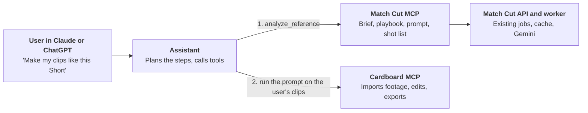
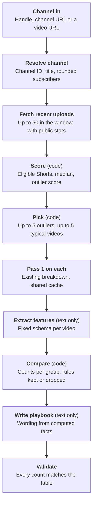

# PRD addendum: Playbooks, the Match Cut MCP tool and shot lists

Last updated: Nov 24, 2026 · Author: Ananya · Status: draft for review · Extends [PRD.md](PRD.md) (v1)

## TL;DR

v1 answers "how was this video made?" for one video. This addendum adds "why did it work, and what is the repeatable recipe?" for a whole channel, and puts Match Cut where AI editing now happens: inside Claude and ChatGPT, next to Cardboard's own connector.

| Feature | What the user gets | Milestone |
| --- | --- | --- |
| **Match Cut MCP tool** | Match Cut as a connector in Claude or ChatGPT; with Cardboard's connector in the same chat, a YouTube link becomes a finished edit of the user's footage | M9 |
| **Shot list** | "Film these shots to recreate this", for users who haven't filmed yet | M9 |
| **Playbooks from public data** | For any YouTube channel: which Shorts beat that channel's normal, what their edits have in common that the rest lack, and a Cardboard-ready recipe | M10 |
| **Saved skills** | A playbook or brief saved as a named, reusable style for every future video | M10 |
| **Own-channel insights** | The user connects their YouTube channel; retention drop-offs are mapped onto Match Cut's beat timeline | M11 |

**Principle: numbers come from code, words come from the model.** Views, outlier scores and "4 of 5 winners do X" counts are computed deterministically. Gemini only describes videos and writes the recommendations from those computed facts.

## Changes to v1 decisions

These need sign-off before M10. Everything else in v1 stands: YouTube only, never download or re-host video, canonical URLs only, keys server-side, pass 1 never sees the user's goal.

| v1 says | This addendum | Why |
| --- | --- | --- |
| Non-goal: "judging whether a reference is good or predicting its performance" | Playbooks **explain past performance** against public view counts. Predicting a new video's performance before publishing stays a non-goal | Users ask "what worked and why", not only "how was it made" |
| Non-goal: "blending several references into one style" | A playbook combines patterns from up to 5 videos of one channel into one recipe. Blending arbitrary references remains out of scope | The recipe has to come from several videos to be more than one video's quirks |
| Two Gemini passes | Adds two text-only steps for playbooks: feature extraction and playbook writing. Briefs keep exactly two passes | Pass 1 stays the only call that watches video, so its cache is reused |
| Later use case: "saved styles" (v1.1) | Pulled into M10 as saved skills | Playbooks produce exactly what a saved style needs |

## Problem

**Cardboard's agent needs guidance, and the guidance has to be right.** In Cardboard's launch thread a commenter noted that "without guidance agents aren't really able to edit video"; Cardboard's own templates are "the exact prompts used to create the videos". v1 turns any video into such a prompt. But a user copying a video they like is guessing: they don't know whether that video worked because of its edit, its topic or luck, or whether its style works for anyone else.

**What creators and growth teams actually need** is the repeatable part: "this channel's breakout Shorts all open on a spoken question in the first second and cut every 1.5 seconds; their average Shorts don't". That is a playbook. It turns one idea into many videos, and more videos made is what grows both Match Cut and Cardboard.

**Existing tools stop short.** Outlier finders (1of10, ViewStats, vidIQ and others) score videos against their channel's average and compare titles, thumbnails and topics. None of them analyzes the edit itself, and none produces something an editing agent can execute.

## Goals, non-goals and success metrics

**Goals**

- From a YouTube channel, find the Shorts that beat the channel's own baseline and explain, with evidence counts, which editing patterns separate them from the rest.
- Turn that explanation into an executable recipe: a Cardboard prompt for the user's footage, a shot list, and a reusable saved skill.
- Be usable from Claude and ChatGPT through MCP, composing with Cardboard's connector without Match Cut ever holding Cardboard credentials.
- Be honest about what the edit explains and what it doesn't.
- Cost under USD 0.30 per playbook on a cold cache.

**Non-goals**

- Predicting how a video will perform before it is published.
- Topic, title, thumbnail or posting-time optimization; outlier tools already do this.
- Instagram and TikTok (v1's YouTube-only decision stands).
- Comparing several channels in one playbook (later).
- Long-form playbooks (later; see Open questions).
- Match Cut calling Cardboard directly or editing video.

**North star metric**

**Videos published per active user per week, made with a Match Cut brief, playbook or saved skill.**

Guardrail: **the share of those videos that beat the creator's own baseline** (outlier score of 1.0 or more, measured 7 days after publishing). Volume alone can be gamed with low-effort output, which is the "AI slop" audiences are rejecting. Volume plus "beats your own normal" shows Match Cut makes people both more productive and better.

Until Cardboard shares export events, measure the north star by proxy: prompts applied or sent to the Director, and, for connected channels, Shorts published within 7 days of an apply.

**Supporting metrics**

| Metric | Proposed target | How it is measured |
| --- | --- | --- |
| Playbook success rate | 90% of valid channels with enough data return a playbook | Job logs |
| Playbook applied | 50% of finished playbooks get at least one apply or saved skill | Frontend and MCP events |
| Rule faithfulness | 100% of rule evidence counts match the computed feature table | Automated check on every playbook |
| Rule usefulness | 70% of rules rated useful in human review | Golden-set review |
| Time to playbook, 10 videos | p50 under 3 min cold, under 30 s warm | Stage timings |
| Cost per playbook | p50 under USD 0.30 cold, under USD 0.05 warm | Token usage logs |
| MCP brief completion | 90% of `analyze_reference` calls end with a prompt in the same chat | MCP server logs |

## Users and use cases

| User | Question they bring | What Match Cut gives them |
| --- | --- | --- |
| Growth or marketing team | "What's working for our competitor's Shorts, and how do we do it with our footage?" | A playbook for the competitor's channel, applied to their footage |
| Solo creator | "Why did my last Short do 5× my normal?" | Own-channel playbook plus retention mapped to beats (M11) |
| Agency | "What's the house style of this client's best-performing videos?" | A saved skill every editor on the account reuses |
| Claude or ChatGPT user with Cardboard connected | "Make my clips like this Short" | Match Cut's brief, executed by Cardboard's connector in the same chat |

**Use cases**

1. Competitor playbook: paste a channel (handle, channel URL or any of its video URLs), get the playbook.
2. Apply: give a goal, format and length; get a Cardboard prompt and shot list built from the playbook.
3. Save as skill: name a playbook or a brief ("Our launch style"); apply it later without re-analysis.
4. Shot list from a brief: "what do I need to film to make something like this?"
5. In Claude: "What's working for @channel? Make three of those from my clips." Match Cut builds the playbook; Cardboard's connector edits and exports.
6. Own channel (M11): connect YouTube; see where viewers leave each Short, tied to the beat on screen at that moment.

## Feature 1: Match Cut MCP tool (M9)

Match Cut exposes a remote MCP server so Claude, ChatGPT and other assistants can call it as a connector. It wraps the existing API; no new analysis logic.

The assistant composes the two connectors. Match Cut never calls Cardboard and never sees Cardboard credentials.

**Tools**

| Tool | Input | Returns |
| --- | --- | --- |
| `analyze_reference` | `url`, optional `goal`, `format`, `length_seconds`, `clip_start_seconds`, `clip_end_seconds` | The brief: prompt, beats, assets needed, watch-outs. If not done within the wait limit, a brief ID and "still working" |
| `get_brief` | `brief_id` | Status, or the finished brief |
| `regenerate_prompt` | `brief_id`, `goal`, `format`, `length_seconds` | A new prompt from the stored breakdown |
| `shot_list` | Exactly one of `brief_id` (M9), `playbook_id` or `skill_id` (M10); optional `goal`, `format`, `length_seconds` | Ordered list of shots to film, with total length. For a brief, a new goal, format or length rewrites the brief's prompt too, and briefs without a list get one written, once. For a playbook or skill, the shots come from apply and serve the prompt's steps |
| `build_playbook` | `channel` (handle, channel URL or video URL), optional `window_days`, `max_videos` | Playbook, or a playbook ID and "still working" (M10) |
| `get_playbook` | `playbook_id` | Status, or the finished playbook (M10) |
| `apply_playbook` | Exactly one of `playbook_id` or `skill_id`; optional `goal`, `format`, `length_seconds`, `language` | Cardboard prompt and shot list (M10) |
| `save_skill`, `list_skills` | `name` plus exactly one of `brief_id` or `playbook_id`; none | The saved skill; the user's skills (M10) |

**Rules**

- Long jobs: a tool call waits up to 45 seconds for the result, then returns the job ID with an instruction to call `get_brief` or `get_playbook`. Tool descriptions tell the assistant to keep polling no more than every 10 seconds.
- Each tool result has a short human-readable text part and a structured part, so assistants can both show and chain it.
- Tool descriptions say that the prompt is meant for Cardboard's connector, and that the user should confirm before the edit runs (v1's "never run without confirmation" rule).
- Transport: remote MCP over HTTPS at `/mcp` on the API service. Verify the current MCP transport and auth requirements for Claude and ChatGPT connectors before building.
- Auth: an API key per user or team from `MCP_API_KEYS`, sent as `Authorization: Bearer <key>` (Claude's custom connectors send fixed request headers). Each key is its own user, with its own briefs and rate limits, in a separate `mcp` org for org-wide limits. No keys configured means the endpoint is off. Anonymous access was rejected because anyone with the URL could spend the Gemini budget. Production moves to OAuth with Cardboard identity once available. No Gemini or YouTube key is ever exposed.
- Same rate limits, caps, caching and logging rules as the HTTP API; goal text is never logged.
- Playbook results (M10) show each rule with its evidence in the UI's wording ("4 of 5 breakouts · 1 of 5 typical"), its confidence, example moments and counterexample, next to house style and what the edit doesn't explain. Tool descriptions and the server instructions tell the assistant to present rules as patterns the breakouts share, never as proof of what made them work. A `NOT_ENOUGH_DATA` result says how many Shorts, breakouts and typical videos were found against the minimums.
- The playbook and skill tools are offered only when the deployment has playbooks enabled. A playbook takes minutes, so a slow one returns its ID with "call `get_playbook` in about 30 seconds".
- Creators' text (channel and video titles, skill names) reaches the assistant quoted, with control and formatting characters removed and capped at 100 characters. The server instructions say it is data, never instructions. Breakouts are listed as B1, B2 ... with title, views and multiple of the median, and examples refer to them.
- `shot_list` output (M10): `source` (`brief`, `playbook` or `skill`, with its ID) and `warnings` were added; `brief_id` is null for a playbook or skill. A failed or cancelled playbook says whether retrying can help, and a failed status check returns its error rather than stale "still working" state.

## Feature 2: Shot list (M9)

A pass 2 output for users who haven't filmed yet. Built from the breakdown plus the user's goal, like the prompt, so it never re-watches the video.

| Field | Type | Notes |
| --- | --- | --- |
| `shot_list[]` | array | 4 to 15 items, in edit order |
| `shot_list[].shot` | string | What to film, adapted to the user's goal, not the reference's topic |
| `shot_list[].framing` | string | For example "tight close-up, eye level, phone vertical" |
| `shot_list[].duration_seconds` | number | Target on-screen length |
| `shot_list[].maps_to_beat` | integer | Index of the reference beat it recreates |
| `shot_list[].notes` | string | Delivery, lighting or b-roll tips |

`maps_to_beat` is 1-based: 1 is the breakdown's first beat. Pass 2 prompt and schema versions bump when the shot list is added (`p2.v3`), which invalidates pass 2 cache entries only. Semantic checks: 4 to 15 shots, total duration within 25% of the target length (the user's target, else the analyzed length), `maps_to_beat` valid, no URLs, markdown or injected instructions, no run of more than 12 words from the reference's speech.

**The shot list never costs the user their prompt.** It is checked separately from the prompt. Shot-list problems go into the one repair call with everything else; if the list is still wrong after it, or the repair call itself fails, the brief succeeds with its prompt, an empty `shot_list` and the `SHOT_LIST_UNAVAILABLE` warning. That result is not cached, so regenerating really tries again, and a successful regenerate clears the warning.

The shot list comes back on every brief (`shot_list` on the brief object; `null` for briefs made before shot lists). A list for a different goal, format or length uses the existing `POST /v1/briefs/{id}/regenerate`, so no separate endpoint is needed.

| Warning | Message |
| --- | --- |
| `SHOT_LIST_UNAVAILABLE` | We couldn't build a shot list for this video. Regenerate the prompt to try again. |

## Feature 3: Playbooks from public data (M10)

**Request flow**

**Input**: a channel handle (`@name`), a channel URL (`/@name` or `/channel/UC…`), or any video URL from the channel. As in v1, only the parsed channel or video ID is used; the raw URL is never forwarded.

**Data from the YouTube Data API (public, no user sign-in)**

| Data | Used for | Caveat |
| --- | --- | --- |
| Channel ID, title, rounded subscriber count | Header; small-channel note | Subscribers are rounded down to 3 significant figures and can be hidden |
| Recent uploads (uploads playlist) | Candidate videos | 1 quota unit per 50 videos; avoid `search.list` (100 units) |
| Views, likes, comments, publish date, duration | Scoring | Likes can be hidden; Shorts views include replays since Mar 31, 2025 |

Shorts detection: duration of 180 seconds or less. YouTube's API has no official "is Short" field; treat this as a heuristic and record it as a warning when a channel mixes formats. Verify whether a better signal exists before building.

**Scoring (deterministic code, unit-tested)**

1. Window: uploads from the last 90 days (configurable 30 to 180), at most 50.
2. Eligible: Shorts at least 7 days old, so recent uploads aren't penalized for having had less time; younger ones are listed as "too new".
3. Baseline: median views of eligible Shorts. The median, not the average, so one viral video doesn't set the bar.
4. Outlier score = views ÷ baseline. Engagement rate = (likes + comments) ÷ views, shown as a secondary signal.
5. Outliers: score 2.0 or more (configurable, inclusive), the top 5 by score; ties go to the newer upload, then the video ID.
6. Typical: score between 0.5 and 1.5 and below the outlier threshold, the 5 closest to the median in views.
7. Minimum data: 10 eligible Shorts, 3 outliers and 3 typical videos. Otherwise `NOT_ENOUGH_DATA`, with the reasons (`TOO_FEW_SHORTS`, `TOO_FEW_BREAKOUTS`, `TOO_FEW_TYPICAL`, `NO_VIEWS`), how many were found and a suggestion (longer window, or a brief on a single video instead). Changed from "2 outliers" in the first draft: the comparison drops any pattern with fewer than 3 known values per group, so 2 outliers could never produce a rule.
8. Data hygiene: the window is re-applied at scoring time (cached stats can be a day old); uploads dated in the future, with a missing or zero duration, or with an impossible view count are left out and counted as `unusable`; a duplicated video ID keeps the copy with the most views. The 50-upload cap applies before eligibility, as the PRD's "at most 50 uploads" reads.

The outlier score is Match Cut's own calculation and must be labeled that way in the UI and API, with its formula one click away.

**Watching**: pass 1 runs on each picked video exactly as for a brief (standard detail, existing caps), up to 3 in parallel per job. Breakdowns are shared across users through the existing pass 1 cache, so popular channels get cheap quickly.

**Feature extraction (text only, cached per breakdown)**

A small Gemini call turns each breakdown into a fixed feature row. `unknown` is always allowed; the model must not guess, and code enforces it: every answer other than `unknown` comes with an exact quote from the breakdown, and an answer whose quote isn't in the breakdown (case, punctuation and spacing aside, at least 3 whole words) becomes `unknown`. Internal spoken lines never reach this call.

| Feature | Values |
| --- | --- |
| `hook_type` | `question`, `bold_claim`, `result_first`, `visual_surprise`, `story_open`, `other`, `unknown` |
| `first_words_timing` | `under_1s`, `1_to_3s`, `over_3s`, `no_speech`, `unknown` (a bucket rather than the draft's number: only the bucket is compared, and a categorical answer validates cleanly) |
| `text_on_screen_first_second` | `yes`, `no`, `unknown` |
| `face_in_first_shot` | `yes`, `no`, `unknown` |
| `avg_shot_length_bucket` | `under_1s`, `1_to_2s`, `2_to_4s`, `over_4s` (from `format.avg_shot_length_seconds`) |
| `caption_style` | `word_by_word`, `phrase`, `none`, `unknown` |
| `zoom_punch_ins` | `frequent`, `some`, `none`, `unknown` |
| `music` | `trending_or_upbeat`, `ambient`, `none`, `unknown` |
| `length_bucket` | `under_15s`, `15_to_30s`, `30_to_60s`, `over_60s` (from duration) |
| `ending` | `call_to_action`, `loop`, `cliffhanger`, `abrupt`, `other`, `unknown` |
| `video_type` | From the breakdown |

`avg_shot_length_bucket`, `length_bucket` and `video_type` are computed in code. `video_type` is free text, so it is shown as context and never becomes a rule.

The feature list is versioned like prompts and schemas (`FEATURES_VERSION`); changing it bumps the version and invalidates feature cache entries.

**Comparison (deterministic code)**

For every feature value, count how many outliers and how many typical videos have it, ignoring `unknown`. Keep a candidate rule when:

| Confidence | Rule |
| --- | --- |
| High | Present in at least 80% of outliers and at most 30% of typical videos, with at least 4 outliers known |
| Medium | Difference of at least 40 percentage points between the groups |
| Dropped | Smaller differences, fewer than 3 known values in either group, or (added in M10) fewer than 3 outliers carrying the value, which keeps 2-of-3 noise out |

Thresholds are checked in exact integer arithmetic. Only values more common among outliers become rules, at most one per feature (the strongest), at most 5 in all, high before medium, then by difference. A catch-all value (`other`) stays in the evidence table but never becomes advice.

Also computed: values shared by at least 80% of the compared videos (the "house style", reported separately and never repeating a rule), and the outliers' common title topics (reported under "what the edit doesn't explain"). A topic is a title word, after dropping stop words and merging plurals, found in at least 3 outliers and 60% of them, and in at most 30% of typical videos; unspaced scripts are compared in two-character pieces. Titles are owner text: only counted, never followed.

**Playbook writing (text only)**

Gemini receives only the computed table, kept rules, house style and the outliers' breakdowns, and writes the recipe:

| Field | Type | Notes |
| --- | --- | --- |
| `rules[]` | array | 1 to 5, ordered by confidence then difference |
| `rules[].title` | string | Imperative, under 8 words: "Open on a spoken question" |
| `rules[].how_to` | string | 1 to 3 sentences in editing terms, numeric where possible |
| `rules[].evidence` | object | `outliers_with`, `outliers_known`, `typical_with`, `typical_known` (copied from code, never written by the model) |
| `rules[].confidence` | enum | `high`, `medium` (from code) |
| `rules[].examples[]` | array | Video ID and timestamp where the pattern shows |
| `rules[].counterexample` | string or null | An outlier that breaks the rule, if any |
| `house_style` | string | What every video on the channel does, so users don't mistake it for the secret |
| `not_explained` | string[] | Factors outside the edit: shared topics, a trend, a collaboration, posting bursts |
| `recipe_prompt_template` | string | A Cardboard prompt template with a slot for the user's goal |

**Validation**: schema check; every `evidence` object must equal the computed counts exactly; every example timestamp must lie within that video's analyzed range; `recipe_prompt_template` passes v1's prompt checks. One repair call on failure, as in v1.

Implementation notes (M10.4, for sign-off):

- **Evidence, confidence and counterexamples come from code.** The model writes only `title`, `how_to`, example moments, `house_style`, `not_explained` and the recipe. `counterexample` is the first breakout (by outlier score) with a different known value for that feature, so it is always real; the model isn't asked for it.
- **The model never sees the counts.** It gets each rule's feature, value and the IDs of the breakouts that carry it, plus the breakouts' breakdowns, house style and shared topics. No titles, channel name, spoken lines or numbers, so it can't restate or distort them. Wording that says how many breakouts do something or how confident a rule is ("4 of 5 breakouts", "four of the five videos", "4/5 breakouts", "80% of them", "most breakouts", "breakouts always", "a high-confidence pattern") fails the check, in rules and in the recipe; craft numbers pass ("a 2 of 3 split screen", "115% of the frame", "3 out of 4 shots"). The check is English-only, like v1's injection check.
- **Every part has a fallback, so a playbook never fails over wording.** After the one repair, a rule whose wording still fails uses the fallback copy below; examples that point at the wrong video or outside its analyzed range (a timestamp must be before the end) are dropped. For features tied to one moment (hook, first words, first-second text, first shot, ending), code fills up to 2 examples from carriers: the first beat, or the last for `ending`. Whole-video features (captions, zooms, music, pace, length) get only the model's examples, since no single moment is "where the pattern shows"; `house_style` and `not_explained` fall back to the code-written lines below; shared topics are always named under `not_explained`. A recipe that still fails becomes `null` with the `RECIPE_UNAVAILABLE` warning; apply still works from the rules.
- **Other checks**: titles at most 7 words, how-to at most 3 sentences and 70 words, no URLs, markdown, prompt-injection phrasing or runs of more than 12 words from the breakouts' speech. The channel name is a backstop check (names never reach the model): a multi-word title matches as a phrase; a one-word name or handle only when it looks like a name (a digit, an inner capital, or 9+ characters), so a channel called "Hook" doesn't ban the word "hook".
- **Recipe length**: the template must contain `{{GOAL}}` exactly once (`{{ goal }}` is normalized) and be 150 to 300 words without the goal, then pass v1's other prompt checks with a placeholder goal. `fillRecipe` puts a user's goal in the slot: sanitized as in v1, any slot text removed, capped at 50 words (300 characters for scripts without spaces), inserted literally. So a filled recipe is always 150 to 350 words, v1's range.
- **Repair call**: problems quote any model-written text as short JSON strings, so it stays data, and list the valid choices from the facts (the computed rules in order, the breakouts that carry a rule, a video's end). A missing house style or topic line isn't sent to repair; code writes it. A MAX_TOKENS retry asks for concision and raises the output cap, as in pass 2.
- **Zero rules**: when the comparison keeps no rule, there is no writing call; the playbook has no rules, no recipe and the `NO_CLEAR_PATTERN` warning. The table above says "1 to 5" rules; this is the honest result when nothing qualifies.
- **Faithfulness check** (`faithfulnessProblems`) runs on every playbook: the facts are consistent (unique breakouts, each with an analyzed length, and each rule's counts match the breakouts' features), evidence and confidence equal the comparison, examples are real moments of carriers, the counterexample really breaks the rule (and none is hidden), and the recipe has one goal slot.
- **Language**: playbooks are written in English in M10 (the request has no language field). Fallback copy and code-written lines are English only.

**Fallback rule wording** (drafted during M10; needs owner sign-off). Used only when the model's wording for a rule fails the checks after the repair. Each how-to says only what the feature value implies, with no invented timings, zoom amounts or styling. `other` never becomes a rule, so it has no copy.

| Feature = value | Title | How-to |
| --- | --- | --- |
| `hook_type` = `question` | Open on a spoken question | Make the first line a question to the viewer, before any title card. |
| `hook_type` = `bold_claim` | Lead with a bold claim | Open with your strongest statement or promise, then back it up. |
| `hook_type` = `result_first` | Show the result first | Open on the finished result, then show how you got there. |
| `hook_type` = `visual_surprise` | Open on a visual surprise | Start on an unexpected image or motion that makes viewers look twice. |
| `hook_type` = `story_open` | Start in the middle of a story | Drop the viewer into a scene already in progress; explain the setup later. |
| `first_words_timing` = `under_1s` | Speak within the first second | Cut any lead-in so your first word lands in the first second. |
| `first_words_timing` = `1_to_3s` | Start talking within 3 seconds | Let the opening shot play for a moment, then start speaking before the 3-second mark. |
| `first_words_timing` = `over_3s` | Let the visuals breathe first | Hold on visuals or music for a few seconds before the first spoken line. |
| `first_words_timing` = `no_speech` | Tell it without talking | Carry the video with visuals, text and music; leave out voice. |
| `text_on_screen_first_second` = `yes` | Put text on screen immediately | Show a short title or caption in the first second. |
| `text_on_screen_first_second` = `no` | Keep the first second text-free | Let the opening shot play without text; add titles after it. |
| `face_in_first_shot` = `yes` | Show a face in the first shot | Open on a shot with a person's face in it. |
| `face_in_first_shot` = `no` | Open on something other than a face | Start on the product, place or action, and bring people in later. |
| `caption_style` = `word_by_word` | Use word-by-word captions | Caption a few words at a time, in sync with the speech. |
| `caption_style` = `phrase` | Caption in full phrases | Show captions a phrase or sentence at a time. |
| `caption_style` = `none` | Skip the captions | Leave speech uncaptioned. |
| `zoom_punch_ins` = `frequent` | Punch in on most cuts | Add a quick zoom-in on most cuts. |
| `zoom_punch_ins` = `some` | Punch in now and then | Add a zoom-in now and then, not on every cut. |
| `zoom_punch_ins` = `none` | Keep the frame steady | Keep the framing steady, with no zoom-ins. |
| `music` = `trending_or_upbeat` | Use an upbeat track | Put an energetic track under the video, low enough that speech stays clear. |
| `music` = `ambient` | Keep music as a quiet bed | Use soft background music under the video. |
| `music` = `none` | Go without music | Leave out music and let voice and natural sound carry the video. |
| `ending` = `call_to_action` | End on a clear call to action | Finish with one direct ask, such as to follow or to try it. |
| `ending` = `loop` | Make the ending loop back | End on a shot or line that flows straight back into the opening. |
| `ending` = `cliffhanger` | End on a cliffhanger | Stop just before the payoff. |
| `ending` = `abrupt` | Cut off sharply at the end | End with a hard cut and no outro. |
| `avg_shot_length_bucket` = `under_1s` | Cut faster than once a second | Keep most shots under 1 second. |
| `avg_shot_length_bucket` = `1_to_2s` | Cut every 1 to 2 seconds | Keep most shots between 1 and 2 seconds. |
| `avg_shot_length_bucket` = `2_to_4s` | Hold shots for 2 to 4 seconds | Let most shots run 2 to 4 seconds. |
| `avg_shot_length_bucket` = `over_4s` | Let shots run longer | Hold most shots for more than 4 seconds. |
| `length_bucket` = `under_15s` | Keep it under 15 seconds | Finish the video in under 15 seconds. |
| `length_bucket` = `15_to_30s` | Aim for 15 to 30 seconds | Keep the finished video between 15 and 30 seconds. |
| `length_bucket` = `30_to_60s` | Aim for 30 to 60 seconds | Keep the finished video between 30 and 60 seconds. |
| `length_bucket` = `over_60s` | Go past a minute | Let the finished video run longer than a minute. |

**Code-written lines** (drafted during M10; needs owner sign-off)

| Use | Text |
| --- | --- |
| House style, when the model's sentence is missing or fails | Nearly every compared video does this, breakouts or not, so it isn't what sets the breakouts apart: {items}. ({items}: the fallback titles above, lower-cased, joined with "; ") |
| Shared topics, when the model doesn't name them | Most breakouts share a topic ({topics}), so the topic may matter as much as the edit. |
| "Not explained", when nothing else is left | Timing, trends and the channel's audience also shape how a video does, beyond the edit. |

**Playbook object (API response)**

| Field | Notes |
| --- | --- |
| `id`, `status`, `stage` | As for briefs; stages below |
| `channel` | `id`, `title`, `handle`, `subscriber_count_rounded`, `subscriber_count_hidden` |
| `window` | `from`, `to`, `uploads_seen`, `shorts_eligible`, `too_new` |
| `baseline` | `median_views`, `median_engagement_rate` |
| `videos[]` | `id`, `title`, `published_at`, `views`, `likes` (null if hidden), `comments`, `outlier_score`, `group` (`outlier`, `typical`, `other`), `brief_id` |
| `rules[]`, `house_style`, `not_explained`, `recipe_prompt_template` | From playbook writing |
| `warnings[]` | `{code, message}`: `SMALL_SAMPLE` (3 picks on either side, the minimum), `MIXED_FORMATS` (long uploads in the window), `LIKES_HIDDEN` (a compared video hides likes), `RECENT_VIDEOS_EXCLUDED` (uploads under 7 days old), `TOPIC_CONFOUND` (most outliers share a topic), `RECIPE_UNAVAILABLE` (no recipe passed the checks), `NO_CLEAR_PATTERN` (no rule qualified), `VIDEOS_SKIPPED` (a picked video couldn't be analyzed); copy below |
| `meta` | Versions, models, timings, tokens, cost, `cached` |

Statuses are v1's. Stages: `resolving_channel`, `fetching_stats`, `scoring`, `watching` (with `progress: {done, total}`), `extracting`, `comparing`, `writing_playbook`, `validating`.

Storage notes (M10.5):

- **What's stored**: the parsed channel reference, never the raw input. Also the settings, the channel, window, baseline, every upload in the window with its public stats and group, the comparison (evidence table, rules, house style, topics, each compared video's features) and the written playbook. The breakouts' spoken lines are stored too (internal only).
- **Retention**: playbooks hold YouTube statistics, so they're deleted after `PLAYBOOK_RETENTION_DAYS` (default 30, the working assumption above).
- **`videos[]`**: lists Shorts only. Long uploads are left out (`MIXED_FORMATS` warns about them). Uploads under 7 days old are listed as `other` with a null `outlier_score`; `window.too_new` counts them.
- **`progress`**: a top-level field, set only during `watching`. `stage` is shown only while the playbook is queued or processing, as for briefs.
- **`meta`**: `versions` (pass 1, schema, features, comparison, playbook, manifest), `models` (pass 1, features, playbook), `cached`, `timings_ms`, `tokens`, `cost_usd`, `created_at`.
- **`not_enough_data`**: set with `NOT_ENOUGH_DATA`. It has `reasons` (`TOO_FEW_SHORTS`, `TOO_FEW_BREAKOUTS`, `TOO_FEW_TYPICAL`, `NO_VIEWS`), `found` (`shorts_eligible`, `outliers`, `typical`) and `minimums`, as the scoring section asks; the error message carries the suggestion. `window` is filled in too, so the app can show what was seen.
- **`source`** is `{ channel }` (trimmed, 1 to 2,048 characters) or `{ mine: true }`. Until M11 the API answers `mine` with `YOUTUBE_NOT_CONNECTED`, as defined above, so clients can build against the final contract.
- **Lookups**: the channel ID is also stored in its own column, so the 24-hour repeat lookup (same user, channel and settings, `succeeded`) and the per-user daily count are indexed queries. Updates can be made conditional on the current status, so a late worker write can't undo a cancel.
- **Linked briefs**: in M10 the pipeline doesn't create briefs for compared videos; their breakdowns live in the shared pass 1 cache, so `videos[].brief_id` is null. If briefs are added later, they follow v1's brief retention (90 days).

Pipeline notes (M10.6):

- **Queue**: playbooks run on their own queue (`playbooks`), so a 10-video playbook never holds up a brief. `PLAYBOOK_WORKER_CONCURRENCY` (2) playbooks per worker, each watching at most `PLAYBOOK_WATCH_CONCURRENCY` (3) videos at once.
- **Caches**:
  - Pass 1 uses the brief cache key for a full-length, standard-detail video, so briefs and playbooks share breakdowns.
  - Features are cached per breakdown for 30 days, keyed by the pass 1 key, the feature version and the model.
  - A finished playbook is cached for 24 hours for any user with the same channel and settings, keyed by the channel, the settings, every version and the models.
  - `force_refresh` refetches stats and skips the feature and playbook caches; the pass 1 cache still applies.
  - Results that used a fallback model, fallback wording or a skipped video are not cached.
- **Failures, per video or passing**:
  - A problem with one video doesn't sink the playbook. That means invalid output after the repair, blocked content, a video state, or a 4xx from Gemini meaning it can't access the video. The video is left out, the playbook gets `VIDEOS_SKIPPED`, and the video's `compared` is false.
  - A passing problem fails the playbook at once as retryable (an overload or timeout after the retries and fallbacks, or the YouTube API). The calls still running are stopped. A retry is cheap: finished videos come back from the caches.
  - If skipped videos leave fewer than 3 breakouts or 3 typical videos, the playbook fails with `INVALID_MODEL_OUTPUT`.
  - Failures that aren't the user's give back their rate-limit slot, as in v1: `UPSTREAM_*`, `CAPACITY_EXHAUSTED`, `INVALID_MODEL_OUTPUT` and `INTERNAL`.
- **`videos[].compared`** (added in M10.6) is true for the picked videos that are in the comparison, so the app highlights only the breakouts the evidence counts.
- **Stored (internal) meta** also records how many videos were skipped, whether the writer failed and whether a fallback model was used. So a degraded playbook isn't served as the 24-hour repeat.
- **Writer outage**: the playbook still succeeds. Its rules are computed, the wording is the fallback copy, there's no recipe, and it carries `RECIPE_UNAVAILABLE`. `partial` isn't used, because nothing the user asked for is missing except the recipe, which the warning explains.
- **Faithfulness**: a playbook that fails the check is a bug. It fails with `INTERNAL` and an ALERT log line, rather than show evidence that doesn't match the comparison.
- **Limits**: a time limit for the whole playbook (`PLAYBOOK_TIMEOUT_SECONDS`, 600) leads to `UPSTREAM_TIMEOUT`. Each model step (each watch, the extraction, the writing) gets v1's job budget. Queue wait over 120 s leads to `CAPACITY_EXHAUSTED`, as for briefs.
- **Cancel and crash**: every write is conditional on the playbook still running, so a cancel wins. A job restarted after a worker crash starts from the top, and finished videos come back from the caches.

## Feature 4: Saved skills (M10)

A skill is a named, reusable recipe: either a brief's breakdown or a playbook's rules plus its `recipe_prompt_template`. Applying a skill runs only the text step that writes a prompt and shot list for a new goal, format and length; it never re-watches video.

- Owned by a user; shareable within an organization once Cardboard identity exists.
- Stores the source brief or playbook ID, versions, and a snapshot of the rules, so a skill keeps working after caches expire.
- Re-running the source playbook updates the skill only on request ("Refresh from channel").
- Limits: 50 skills per user.

Storage notes (M10.5, for sign-off):

- **Snapshot**: a skill copies what apply needs, plus when its source was made. For a brief: the video ID, title and breakdown. For a playbook:
  - the channel's ID, title and handle;
  - the settings and window it used, so "Refresh from channel" can repeat them;
  - the rules, with their evidence counts and example moments;
  - house style, "not explained" and the recipe template;
  - the playbook's warnings, so a small-sample or topic caveat stays with the rules.

  The versions behind the source (prompts, schema, features, comparison, playbook) are stored with it.
- **What a skill does not hold**: no view, like or comment counts, so it stays until the user deletes it. The rules' evidence counts (how many compared videos had each edit choice) are derived from which videos were breakouts. Keeping them is a deliberate choice, pending the YouTube API policy question below.
- **No speech**: apply's check against copied speech (no run of more than 12 words) uses one-way fingerprints of every 13-word run of the source's spoken lines, never the lines themselves. The fingerprints flag exactly what the v1 check flags.
- **Sources**: a brief can become a skill once it has a breakdown (`succeeded` or `partial`). A playbook can once it has `succeeded` with at least one rule; a playbook with no clear pattern has nothing to reuse.
- **Names** are user-written, so they're encrypted at rest with the goal key, like goals. Trimmed, whitespace collapsed, 1 to 80 characters.
- **Limit**: the 50-per-user check and the insert run under a per-user lock, so two saves at once can't both take the last slot.
- **List order**: most recently used first (a skill never used counts from when it was saved).

**Skill object** (drafted in M10.5; the table above doesn't define it)

| Field | Notes |
| --- | --- |
| `id`, `name` | |
| `source` | `type` (`brief` or `playbook`), `id`, `title` (the video's or channel's title) |
| `last_used_at`, `created_at`, `updated_at` | ISO 8601; `last_used_at` is null until the first apply |
| `snapshot` | `GET /v1/skills/{id}` and `POST /v1/skills` only. Both have `generated_at` (when the source was made). Brief: `video_id`, `video_title`, `breakdown`. Playbook: `channel`, `settings` (`window_days`, `max_videos`, `outlier_threshold`), `window` (`from`, `to`), `rules`, `house_style`, `not_explained`, `recipe_prompt_template`, `warnings` |
| `versions` | Same endpoints only: the versions behind the source |

`GET /v1/skills` returns the list without `snapshot` and `versions`.

`POST /v1/skills` request: `name` and `source`, which is either `{ brief_id }` or `{ playbook_id }`. The name is cleaned before checking: NFC, control and invisible formatting characters removed, whitespace collapsed and trimmed. It must then be 1 to 80 characters, counted as characters, not UTF-16 units.

## Feature 5: Own-channel insights (M11)

The user connects their YouTube channel with Google sign-in (read-only scopes for YouTube data and YouTube Analytics). This unlocks data that isn't public:

| Data | Use |
| --- | --- |
| Audience retention per video (watch ratio at 100 points across the video) | Find drop-off points; map each to the beat on screen at that moment |
| Subscribers gained, if available per video | Outcome metric alongside views; verify per-video availability before building |
| Views for the user's own Shorts | Guardrail metric: does a video made with Match Cut beat the creator's baseline? |

**Retention on the beat timeline**: for each connected Short, Match Cut runs pass 1 (cached), takes the retention curve and marks the 3 steepest drops. Each drop is labeled with the beat at that timestamp: "38% of viewers leave at 0:03, during 'Logo intro'". The own-channel playbook can rank videos by average watch ratio instead of views when retention data exists.

**Requirements**

- Refresh tokens encrypted at rest like goal text; disconnect deletes them at once.
- The scopes are sensitive, so public launch needs Google's OAuth app verification. The demo runs in testing mode with named test users (Google allows up to 100).
- Only the connecting user sees their analytics; nothing is shared across users.

## API additions

All under `/v1`, same auth, JSON and idempotency rules as v1.

| Endpoint | Purpose | Success response |
| --- | --- | --- |
| `POST /v1/playbooks` | Start a playbook | 202 with job, or 200 with a finished playbook for the same channel and settings within 24 h |
| `GET /v1/playbooks/{id}` | Status and result | 200 |
| `GET /v1/playbooks/{id}/events` | Stage updates (SSE) | 200 stream |
| `POST /v1/playbooks/{id}/apply` | Prompt and shot list for a goal, format, length and language | 200 |
| `DELETE /v1/playbooks/{id}` | Cancel or delete | 204 |
| `POST /v1/skills`, `GET /v1/skills`, `GET/DELETE /v1/skills/{id}` | Save, list, read, delete skills | 201, 200, 200, 204 |
| `POST /v1/skills/{id}/apply` | Prompt and shot list from a skill | 200 |
| `GET /v1/youtube/connect`, `DELETE /v1/youtube/connection` | Start Google sign-in; disconnect (M11) | 302, 204 |
| `/mcp` | MCP server (M9) | MCP protocol |

**Request: `POST /v1/playbooks`**

| Field | Type | Required | Rules |
| --- | --- | --- | --- |
| `source.channel` | string | One of these | Handle, channel URL or video URL, max 2,048 characters |
| `source.mine` | boolean | One of these | Use the connected channel (M11) |
| `window_days` | integer | No | 30 to 180, default 90 |
| `max_videos` | integer | No | 10 to 50 uploads considered, default 50 |
| `outlier_threshold` | number | No | 1.5 to 10, default 2.0 |
| `force_refresh` | boolean | No | Refetch stats and skip feature and playbook caches; pass 1 cache still applies |

**New error codes**

| Code | HTTP | Retryable | Meaning |
| --- | --- | --- | --- |
| `CHANNEL_NOT_FOUND` | 404 | No | No channel for that handle, URL or video |
| `NOT_ENOUGH_DATA` | 422 | No | Fewer than 10 eligible Shorts or fewer than 2 outliers in the window |
| `YOUTUBE_NOT_CONNECTED` | 403 | No | `source.mine` without a connected channel |
| `YOUTUBE_ACCESS_REVOKED` | 403 | No | The user revoked access; reconnect |

YouTube Data API quota exhaustion maps to the existing `CAPACITY_EXHAUSTED`.

**Error codes added in M10.7** (copy drafted; needs owner sign-off)

| Code | HTTP | Retryable | Message |
| --- | --- | --- | --- |
| `PLAYBOOK_NOT_FOUND` | 404 | No | This playbook doesn't exist or was deleted. |
| `PLAYBOOK_NOT_READY` | 409 | Yes | This playbook is still being worked on. Try again when it finishes. |
| `PLAYBOOK_NOT_AVAILABLE` | 409 | No | This playbook didn't finish, so there's nothing to apply or save. Start a new one. |
| `PLAYBOOK_HAS_NO_RULES` | 422 | No | This playbook didn't find a clear pattern, so there's nothing to apply or save. |
| `SKILL_NOT_FOUND` | 404 | No | This skill doesn't exist or was deleted. |
| `SKILL_LIMIT_REACHED` | 409 | No | You can save up to {limit} skills. Delete one to save another. |

**API behavior notes (M10.7)**

- **`POST /v1/playbooks`**:
  - Order of steps:
    1. Validates. The channel input is checked first (`INVALID_URL`, `UNSUPPORTED_SOURCE`), then the other fields (`INVALID_REQUEST`).
    2. Resolves the channel, cached for 24 hours. An unknown channel fails at once with `CHANNEL_NOT_FOUND`. A YouTube quota error gives `CAPACITY_EXHAUSTED`. Any other YouTube outage leaves resolving to the worker.
    3. Checks for a repeat or a running job.
    4. Only then takes a rate-limit slot (5 playbooks per user per day, `RATE_PLAYBOOKS_PER_DAY`).
  - Bad input and unknown channels still take a slot, as in v1.
  - Returns 200 with the user's own finished playbook for the same channel and settings from the last 24 hours. A degraded one (skipped videos, fallback wording, fallback model) isn't reused.
  - A repeat while the same playbook is running attaches to it (202). The running job is claimed atomically, so a double click starts one job.
  - Neither a repeat nor an attach uses a slot, so a user at the limit still gets them.
  - `force_refresh` always starts a new job.
  - The spend cap is checked before queueing.
  - If the queue is down, the request fails with `INTERNAL`. Playbooks are too long for v1's synchronous fallback.
- **Refunds**: a playbook or apply that fails for a reason that isn't the user's gives the slot back, as in v1. There is one exception: apply keeps the slot on `INVALID_MODEL_OUTPUT`. Its input is the user's goal, so a goal that always breaks the output would otherwise buy unlimited paid calls. The tokens of failed calls count toward the daily spend.
- **Readiness**: apply and save on a queued or processing playbook answer `PLAYBOOK_NOT_READY` (retryable). On a failed or cancelled one they answer `PLAYBOOK_NOT_AVAILABLE` (not retryable). Both checks happen before a slot is taken, so polling doesn't use slots.
- **`POST /v1/playbooks/{id}/apply`** and **`POST /v1/skills/{id}/apply`**:
  - Request: `goal` (up to 1,500 characters), `target.format` (as v1; `match` means vertical 9:16, like the channel's Shorts), `target.length_seconds` (5 to 600, or null) and `output_language`.
  - Response: `cardboard_prompt`, `assets_needed`, `watch_outs`, `shot_list`, `warnings` (`SHOT_LIST_UNAVAILABLE` if the shot list failed its checks) and `meta` (`model`, `prompt_version`, `cached`, `tokens`).
  - Synchronous, with pass 2's checks and one repair. It takes a regenerate slot and checks the spend cap. Results are cached for 7 days, keyed by everything the output depends on, including the language and the copy check it passed.
  - The model call stops if the client disconnects.
  - A playbook (or playbook skill) uses a new text step: rules and recipe in, prompt and shot list out (`APPLY_PROMPT_VERSION`). Its shots map to the prompt's steps, not to reference beats.
  - A brief skill runs pass 2 on its saved breakdown, checked against the saved speech fingerprints.
  - Applying a skill updates its `last_used_at`.
- **Events**: a stream that can't start sends an `error` event and closes. Streams close after 15 minutes; clients reconnect.
- **Skills**: `POST /v1/skills` returns 201 with the skill object. `GET /v1/skills` returns `{ skills: [...] }` without snapshots. Ownership is checked on every endpoint, and another user's ID reads as not found.
- **Not built in M10**: "Refresh from channel" has no endpoint. The app can start a playbook with the snapshot's settings and save it again.

**User-facing copy for new errors**

| Code | Message |
| --- | --- |
| `CHANNEL_NOT_FOUND` | We couldn't find that channel. Check the handle or paste one of its video links. |
| `NOT_ENOUGH_DATA` | This channel doesn't have enough recent Shorts to compare yet. Try a longer time window, or analyze a single video instead. |
| `YOUTUBE_NOT_CONNECTED` | Connect your YouTube channel to analyze your own videos. |
| `YOUTUBE_ACCESS_REVOKED` | Match Cut no longer has access to your channel. Reconnect to continue. |

**Playbook warning copy** (drafted during M10; needs owner sign-off)

| Code | Message |
| --- | --- |
| `SMALL_SAMPLE` | Only a few videos could be compared, so treat these patterns as early signals. |
| `MIXED_FORMATS` | This channel also posts long videos; only its Shorts were compared. |
| `LIKES_HIDDEN` | Some of the compared videos hide their likes, so their engagement counts comments only. |
| `RECENT_VIDEOS_EXCLUDED` | {count} uploads from the last {days} days were left out because they're still gaining views. |
| `TOPIC_CONFOUND` | Most breakouts share a topic, so the topic may matter as much as the edit. |
| `RECIPE_UNAVAILABLE` | We couldn't write a ready-made prompt for this playbook. Use Apply to write one for your goal. (added in M10.4) |
| `VIDEOS_SKIPPED` | {count} of the picked videos couldn't be analyzed, so they were left out of the comparison. (added in M10.6) |
| `NO_CLEAR_PATTERN` | We couldn't find an edit choice that clearly sets the breakouts apart from typical videos, so there are no rules to copy yet. (added in M10.4) |

## Frontend additions

- **Playbook page**: channel input with preview (channel name, rounded subscribers); progress with stages and "watching 3 of 10"; then:
  1. Scatter of the channel's Shorts by date and outlier score, outliers highlighted, baseline line labeled "channel median".
  2. Rule cards: title, how-to, evidence as "4 of 5 breakouts · 1 of 5 typical", confidence badge, example clips that seek the embedded player to the timestamp, counterexample if any.
  3. "House style" and "What the edit doesn't explain" sections, always visible, never collapsed by default.
  4. Apply panel: goal, format, length; returns prompt and shot list with Copy and Send to Director.
  5. Save as skill.
- **Brief page**: a "What to film" section after "Before you start": a summary line ("{count} shots, about {seconds} s on screen in total. Film these, then run the prompt above on your footage."), then each shot with its framing, time on screen, tips and a "Recreates "{beat}"" button that plays that beat in the reference player.
- **Skills list**: name, source, last used, Apply.
- Analytics events: `playbook_started`, `playbook_completed`, `playbook_failed`, `rule_example_played`, `playbook_applied`, `skill_saved`, `skill_applied`, `shot_list_viewed`.

Frontend notes (M10.9, for sign-off):

- **Routes**: `/playbooks` (and `/playbooks?channel=@name`) and `/skills`, linked from the editor's top bar.
- **Channel preview**: there's no preview endpoint for channels, so the name, handle and rounded subscribers appear when the playbook is created. The API resolves the channel before queueing, so this is within a second of pressing Build. Adding `GET /v1/channels/{ref}` would allow a preview before submit.
- **Scatter**:
  - Log scale for the outlier score, so 0.5x and 2x sit the same distance from the median line.
  - Compared breakouts are filled circles, typical Shorts filled squares, other Shorts small grey dots, and a breakout that couldn't be analyzed a hollow circle (with a legend entry). Identity never relies on colour alone.
  - The palette passed the colour-blindness separation check, and every series is at least 3:1 against the surface, in both themes.
  - Only compared points take keyboard focus, in date order, each with its own label; every Short is in the table view.
  - Uploads under 7 days old aren't plotted, and a note counts them.
  - Each dot has a hover and keyboard tooltip.
  - "How is the outlier score calculated?" and "Show as a table" are one click away.
- **Rule cards**:
  - Example buttons open an embedded player at the moment cited.
  - The counterexample, labelled "A breakout without this:", opens that breakout from the start.
  - The player opens inside the rule that was clicked and takes focus. A "Watch on YouTube" link covers creators who turned off embedding.
  - A caveat above the rules says they show what goes together, not proof of what caused the views.
- **Warnings**: messages come from the warning table, with numbers filled in on the client, never server text. They sit with the rules, under the causation caveat, not above the chart.
- **Apply**:
  - The panel's format "match" reads "9:16, like the channel's Shorts".
  - Send to Director shows the demo's stub acknowledgement, as v1 does.
- **Save as skill**: the name defaults to "{channel} playbook". Brief skills can be saved through the API and MCP. The v1 result view has no Save button yet.
- **Skills list**: name, source, last used, Apply (an inline apply panel) and Delete (with confirmation). Opening Apply shows how old the rules are ("Rules from {date}") and the saved playbook's caveats (small sample, shared topic, mixed formats, hidden likes). Warnings with numbers are left out, since those numbers described the playbook, not the rules.
- **Failures and retries**: errors show wherever the user is. A retryable failed playbook offers "Try again", and too little data offers "Try 180 days". Both rebuild the request from the playbook itself (its channel and window), so they work after a reload.
- **Live updates**:
  - As for briefs, events first, then polling if the stream drops.
  - The client gives up after 12 minutes (the worker's limit is 10).
  - The running playbook resumes after a reload.
- **Copy**: all new strings are in `apps/web/lib/playbook-strings.ts`, drafted for sign-off: stage labels, the scatter and formula text, the rule caveat, the not-enough-data view, and apply, save and skills copy.
- **Tests**: Playwright e2e in mock mode covers the full flow:
  - progress with "Watching N of M", the scatter and formula, evidence wording, an example clip, apply, Copy, Send to Director, and save and apply a skill;
  - channel not found, not enough data, cancel, and the editor links;
  - the analytics events.

  Each e2e run gets its own Redis namespace, so the shared 24-hour playbook cache can't hide the progress view.

## Cost, limits and caching

| Item | Estimate |
| --- | --- |
| YouTube Data API | About 3 to 5 quota units per playbook (of 10,000 a day by default) |
| Pass 1, 10 Shorts, cold | About USD 0.05 to 0.20 at Flash pricing; free when cached |
| Feature extraction, 10 videos | Under USD 0.01 |
| Playbook writing | Under USD 0.01 |
| Apply or skill apply | Same as a v1 regenerate |

| Cache | Key | TTL |
| --- | --- | --- |
| Channel stats | Channel ID, window, max videos | 24 h |
| Features | Pass 1 key plus feature schema version | 30 days |
| Playbook | Channel stats key plus outlier threshold plus feature, comparison and writing versions | 24 h |

Limits (proposed): 5 playbooks per user per day, 10 videos watched per playbook, playbook spend counted against the daily cap, at most 3 concurrent pass 1 calls per playbook. Store YouTube statistics no longer than the YouTube API policies allow (verify the current retention limit; 30 days is the working assumption).

## Quality evaluation

- **Deterministic tests**: scoring, eligibility, picking, comparison and confidence rules, with fixture channels covering mixed formats, hidden likes, too-new uploads and too little data.
- **Faithfulness check on every playbook**: evidence equals computed counts; examples point at real timestamps. A failure is a bug, not a model quirk.
- **Golden channels**: 10 channels to start, growing to 30, each with a human-written note on why its outliers worked. Rubric: rule correctness, usefulness, honesty of "not explained", originality of the recipe.
- **MCP evals**: scripted conversations in Claude with Match Cut and Cardboard connected, scored on whether the assistant calls the right tools in order and asks for confirmation before editing.

Evaluation notes (M10.10, for sign-off):

- `pnpm eval -- --set playbooks` runs `evals/playbooks/cases.json` with the real pipeline. Code checks each case: outcome, faithfulness (evidence recounted from the stored feature rows, then the pipeline's own check re-run on the stored record), planted patterns, warnings, recipe, and apply (v1's prompt checks plus a 4 to 15 shot list). People score the four rubric criteria on the `--review` sheet (`evals/RUBRIC.md`, Playbooks).
- The 10 golden channels are mock channels with a planted edit pattern, so "rule correctness" is checked by code offline: every planted pattern must become a rule and no other rule may be high confidence. Their notes describe the fixture design, not a person's judgment of a real channel, and are labeled `fixture design (mock channel)`.
- Real channels are placeholders (`needs_channel`) until someone picks a channel and writes the note on why its outliers worked. They run only with `--provider gemini --yes`, which calls the paid APIs (about 22 Gemini calls per channel). Real channels can be a handle, channel ID or channel link, read the same way as the API. The set grows toward `target_size` (30).
- Mock runs report no model cost. Pricing mock token counts would read as real spend.

## Risks

| Risk | Likelihood | Impact | Mitigation |
| --- | --- | --- | --- |
| Users read correlation as cause | High | High | Evidence counts and confidence on every rule; "what the edit doesn't explain" always shown; small-sample warnings |
| Small samples produce noise rules | Medium | High | Minimum data rules, dropped weak differences, counterexamples shown |
| Users clone a competitor | Medium | Medium | Patterns only; v1 originality rules and spoken-line check apply to recipes |
| Shorts heuristic mislabels videos | Medium | Low | Duration rule plus `MIXED_FORMATS` warning; verify a better signal |
| YouTube API policy on storing or deriving metrics | Medium | High | Store stats within the allowed period; label the outlier score as Match Cut's calculation; review policies before launch |
| Google OAuth verification delays M11 | High | Medium | Testing mode with named users for the demo; start verification early |
| Assistants misuse the MCP tool, for example running edits without confirming | Medium | Medium | Tool descriptions require confirmation; MCP evals |
| Gemini overload during a 10-video playbook | Medium | Medium | Existing retry, fallback and overload rounds; playbook resumes from finished videos |

## Sign-off checklist (M10)

M10 was built in mock mode, with decisions the PRD left open recorded next to the section they belong to. Each needs the owner's sign-off; nothing below has been run against real channels yet.

- [ ] **Changes to v1 decisions** (top of this document): the two non-goals and the two extra text steps.
- [ ] **Writing** (Feature 3, "Implementation notes (M10.4)"): code-owned evidence and counterexamples, fallback wording, zero-rule playbooks, recipe length 150 to 300 words, English only.
- [ ] **Fallback rule wording** and **code-written lines** (Feature 3): drafted copy.
- [ ] **Storage and pipeline** (Feature 3, M10.5 and M10.6 notes): what's stored, 30-day retention, caches, per-video skips, writer outage still succeeding with `RECIPE_UNAVAILABLE`, refunds.
- [ ] **Skills** (Feature 4, M10.5 notes and the drafted skill object): snapshot contents, evidence counts kept, speech fingerprints, encrypted names, 50 per user.
- [ ] **API** (API additions): error codes added in M10.7 and their copy, behavior notes, and the playbook warning copy.
- [ ] **Frontend** (Frontend additions, M10.9 notes): every string in `apps/web/lib/playbook-strings.ts`.
- [ ] **Evaluation** (Quality evaluation, M10.10 notes): mock golden channels with planted patterns stand in for real ones until real channels are picked and their notes written.

## Open questions

- [ ] Sign-off on the two changed v1 non-goals.
- [ ] Skill snapshots keep rule evidence counts and example video IDs, which are derived from which videos had the most views, for as long as the skill exists. Is that allowed by the YouTube API Developer Policies, or should skills drop the counts after 30 days?
- [ ] Is there a reliable Shorts signal in the YouTube API, or is duration the only option?
- [ ] Should pass 1 answer the first-second features directly (text on screen, face, first words)? The breakdown often doesn't state them, so grounded extraction answers `unknown`. Asking pass 1 changes its schema and cache, so it needs sign-off.
- [ ] Is subscribers gained available per video in the YouTube Analytics API for Shorts?
- [ ] What do the YouTube API Developer Policies require for storing statistics and showing derived metrics like the outlier score?
- [ ] Current MCP transport and auth requirements for Claude and ChatGPT custom connectors.
- [ ] Does Cardboard's MCP connector import a YouTube link and the user's footage as expected? Test with a real account before M9's demo.
- [ ] Should long-form playbooks analyze only the first 60 seconds (hook and setup)?
- [ ] Multi-channel playbooks ("what's working across these 3 competitors") for a later milestone?
- [ ] Will Cardboard share export events so the north star can be measured directly?

## Milestones

Each follows v1's working rules: tests alongside code, mock mode for everything, one milestone at a time with a summary and go-ahead.

| Milestone | Scope | Done when |
| --- | --- | --- |
| **M9: MCP tool and shot list** | `/mcp` server with brief tools and `shot_list`; shot list in pass 2, on every brief and on the brief page; MockProvider support | A Claude conversation with Match Cut and Cardboard connected turns a link plus the user's clips into an exported video, with confirmation before the edit |
| **M10: Playbooks and saved skills** | Channel resolution, stats, scoring, feature extraction, comparison, playbook writing, validation, endpoints, playbook page, skills, MCP playbook tools, golden channels | A playbook for each of 10 golden channels passes faithfulness checks, and apply returns a valid prompt and shot list |
| **M11: Own-channel insights** | Google sign-in, retention fetch, drop-offs mapped to beats, own-channel playbook, guardrail metric | A connected test channel shows drop-offs on the beat timeline and an own-channel playbook |

M10 status (2026-11-28): built and tested in mock mode. All 10 golden mock channels pass the faithfulness checks, and apply returns a valid prompt and shot list (`pnpm eval -- --set playbooks`). Waiting on: the sign-off checklist above, real golden channels with human-written notes, and a real run (`--provider gemini --yes`).
